<div align="center">

# CS Flow

**CS 지식을 눈으로 보며 익히는 학습 플랫폼**

외우는 대신 직접 돌려 보며 이해합니다. 개념마다 Canvas 시각화를 조작하고, 코드로 연결하고, 퀴즈로 확인합니다.

[**csflow.kr**](https://csflow.kr)


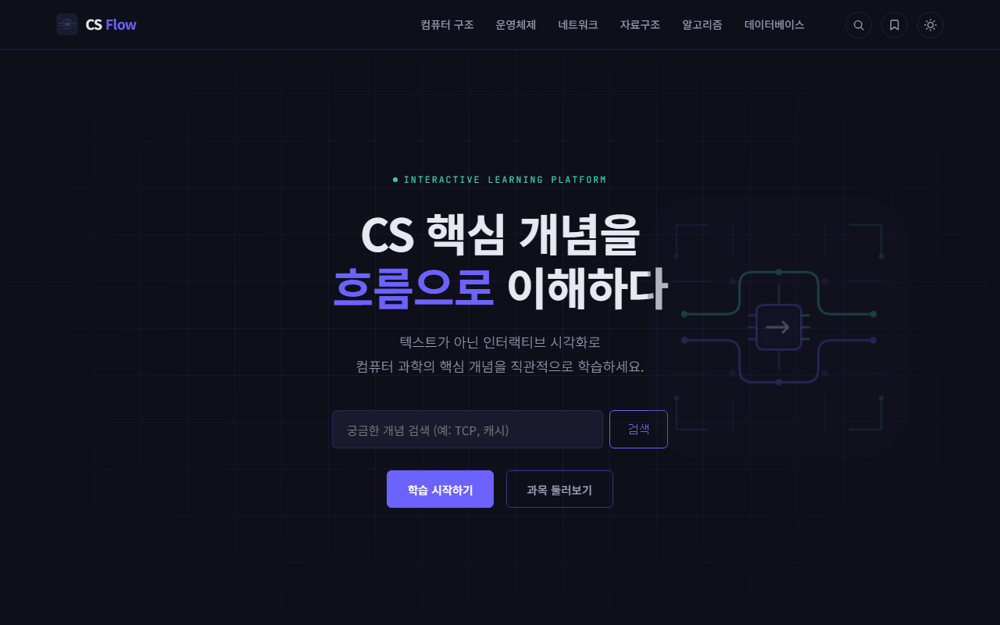

</div>

<br>

## 프로젝트 소개

CS 전공 지식은 글로만 읽으면 머릿속에서 그려지지 않는 것이 많습니다. 페이지 교체 알고리즘, TCP 혼잡 제어, B-Tree 분할, MVCC 같은 개념은 **시간에 따라 상태가 변하는 과정**이 핵심입니다.

CS Flow는 이런 개념을 단계별로 직접 실행해 보게 만든 학습 사이트입니다. 한 토픽은 네 탭으로 구성됩니다.

| 탭 | 내용 |
|---|---|
| 큰 그림 | 왜 필요한지, 무엇이 문제인지, 핵심 개념을 글로 정리 |
| 작동 원리 | Canvas 시각화. 재생 · 단계 실행 · 리셋 · 속도(1x~3x) · 모드 전환. 단계마다 자막으로 설명하고, 일부 토픽은 3D로도 볼 수 있음 |
| 코드 연결 | 개념이 실제 코드와 명령어에서 어떻게 나타나는지 |
| 퀴즈 | 4지선다 · 힌트 · 해설. 전 문항을 맞히면 학습 완료로 기록 |

본문은 공식 문서 · 논문 · 교재로 확인한 사실만 씁니다.

<br>

## 과목

6개 과목 × 20개 토픽, 총 **120개 토픽**을 공개했고, 쿠키 · 세션 · JWT, CORS, N+1 문제, ROS 2 같은 기초 · 응용 토픽을 이어서 추가하고 있습니다.

| 과목 | 다루는 내용 (일부) |
|---|---|
| 컴퓨터 구조 | 파이프라이닝, 캐시 메모리, 가상 메모리, RISC |
| 운영체제 | CPU 스케줄링, 교착 상태, 프로세스 동기화, Copy-on-Write |
| 네트워크 | TCP 혼잡 제어, HTTPS / TLS, DNS, 멀티캐스트 |
| 자료구조 | 해시 테이블, 힙, 트라이, 세그먼트 트리 |
| 알고리즘 | 다익스트라, 벨만-포드, 분할 정복, 단조 스택 |
| 데이터베이스 | 인덱스, 트랜잭션, MVCC, 백업 / 복구(WAL), 전문 검색 |

<br>

## 화면 구성

### 큰 그림 · 작동 원리

<table>
  <tr>
    <td width="50%">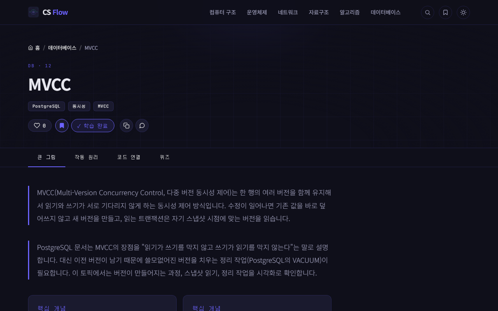</td>
    <td width="50%">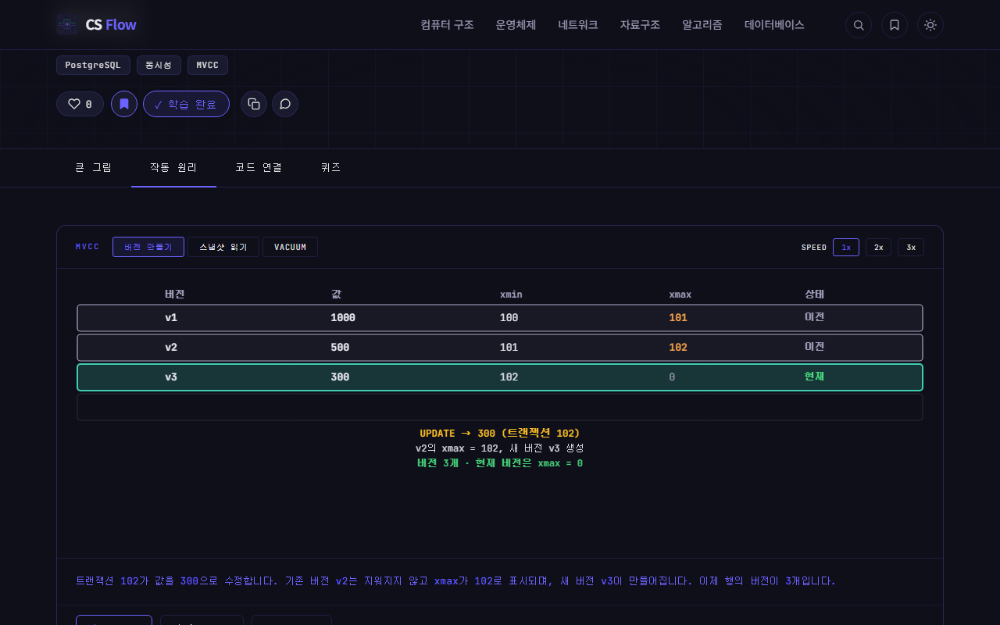</td>
  </tr>
  <tr>
    <td align="center">개념을 글과 구조로 정리</td>
    <td align="center">Canvas 시각화를 직접 조작</td>
  </tr>
</table>

### 3D 팝업북

<div align="center">
  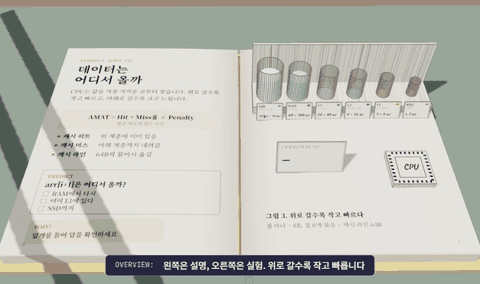
  <br>
  메모리 계층 구조 — 데이터가 SSD → RAM → 캐시 → CPU로 올라오는 모습을 책 위의 유리병으로 따라갑니다
</div>

### 코드 연결 · 퀴즈

<table>
  <tr>
    <td width="50%">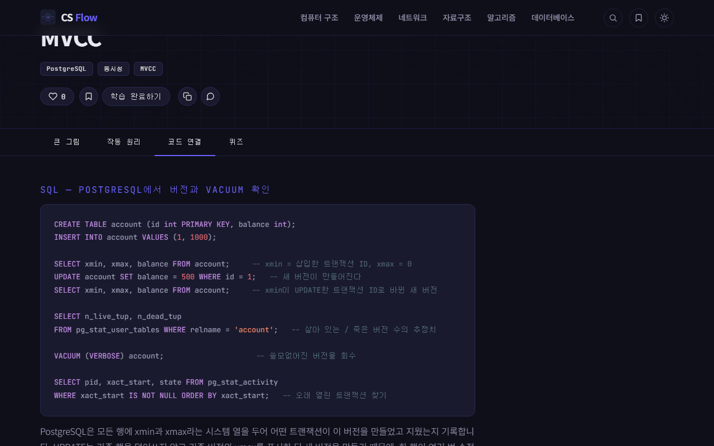</td>
    <td width="50%">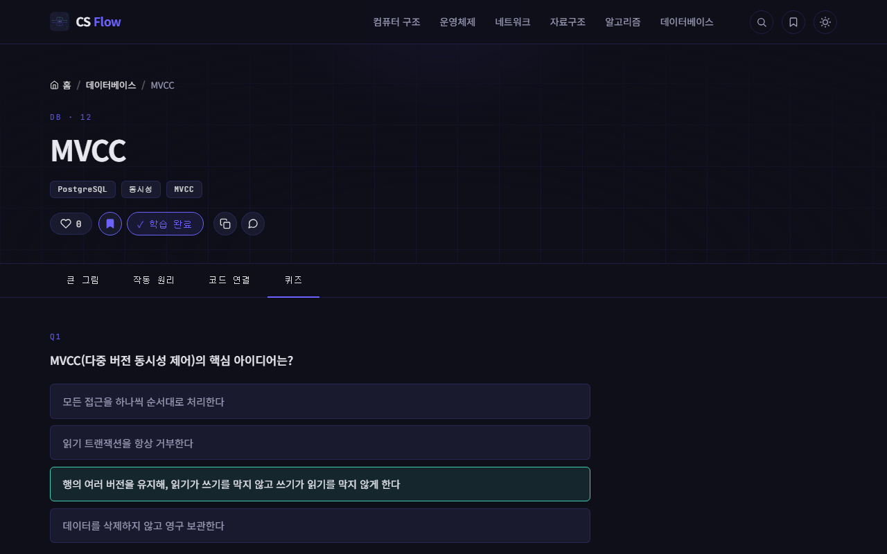</td>
  </tr>
  <tr>
    <td align="center">개념을 실제 코드와 명령어로 연결</td>
    <td align="center">정답은 서버에서만 채점 (힌트 → 해설)</td>
  </tr>
</table>

### 과목 · 검색 · 내 학습

<table>
  <tr>
    <td width="33%">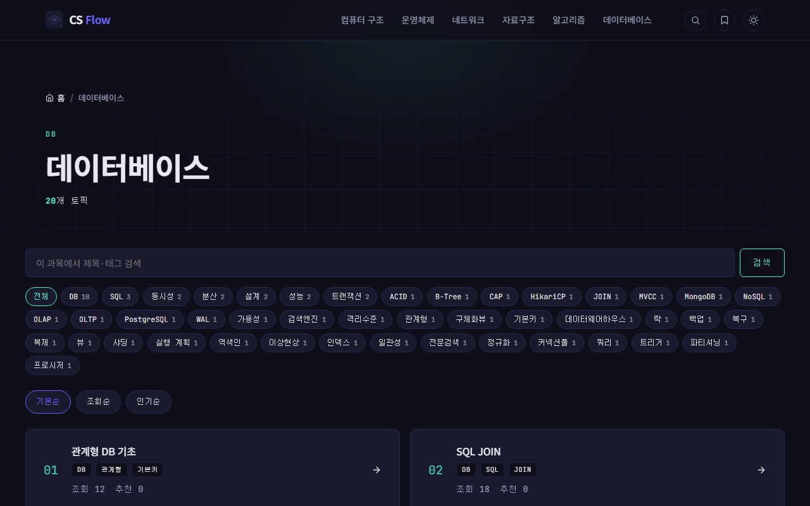</td>
    <td width="33%">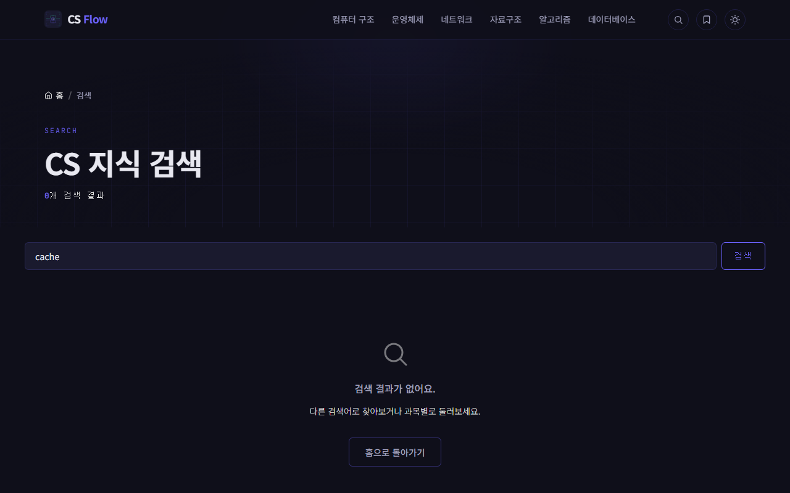</td>
    <td width="33%">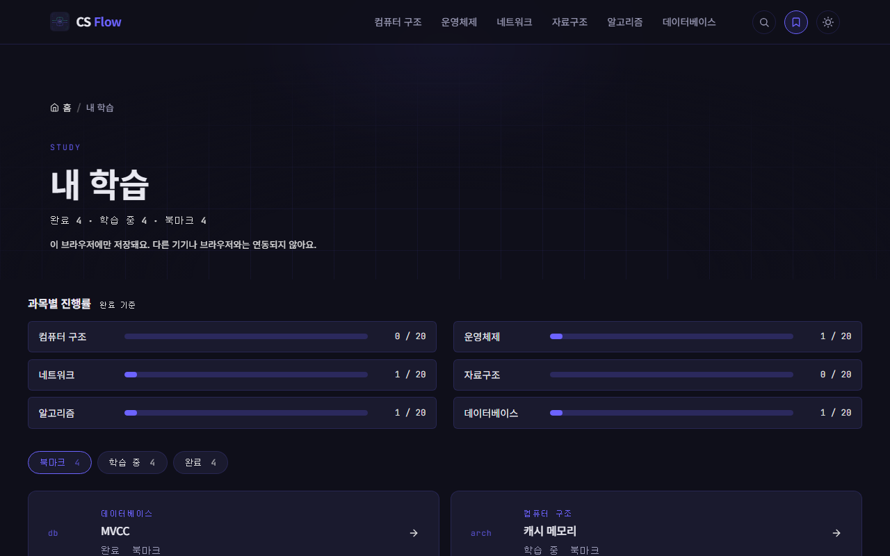</td>
  </tr>
  <tr>
    <td align="center">태그 필터 · 정렬(기본 · 조회 · 인기)</td>
    <td align="center">전체 토픽 검색</td>
    <td align="center">과목별 진행률 · 북마크 · 학습 중 · 완료</td>
  </tr>
</table>

### 테마 · 모바일

<table>
  <tr>
    <td width="66%">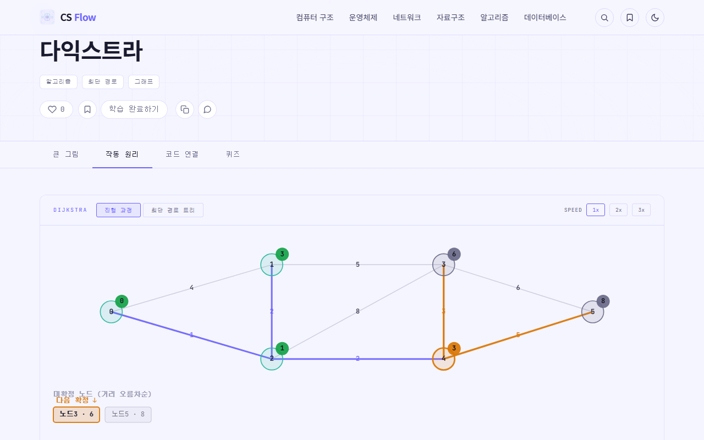</td>
    <td width="34%">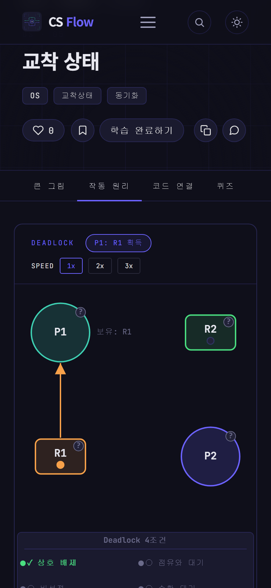</td>
  </tr>
  <tr>
    <td align="center">다크 / 라이트 테마</td>
    <td align="center">모바일 반응형</td>
  </tr>
</table>

<br>

## 주요 기능

- **Canvas 시각화** — 라이브러리 없이 바닐라 JS로 구현. 토픽마다 재생 · 단계 실행 · 리셋 · 속도 조절을 같은 방식으로 제공하고, 화면의 수치와 설명 자막이 같은 데이터에서 나옵니다. 자막은 사이트 테마(다크 / 라이트) 색을 따릅니다.
- **3D 팝업북** — 메모리 계층 구조 토픽에서 three.js로 책 위의 유리병 6개를 따라 데이터가 흐르는 모습을 봅니다. 버튼을 눌렀을 때만 불러오고, 작동 원리 탭을 벗어나면 GPU 자원을 모두 해제합니다. 드래그로 회전, 우클릭 드래그로 이동, 휠 · 핀치로 확대하며, 그래픽 가속이 꺼진 브라우저에서도 같은 화질로 열립니다(CPU 사용량이 늘어 안내 도움말을 보여 줍니다).
- **퀴즈 서버 채점** — 정답은 화면에 내려가지 않고 서버에서만 채점합니다.
- **내 학습** — 로그인 없이 브라우저(localStorage)에 학습 상태 · 북마크 · 마지막 학습 토픽을 저장합니다. 저장값은 읽을 때마다 형식을 검증합니다. 홈에서는 마지막 토픽으로 이어서 학습할 수 있습니다.
- **검색 · 필터** — 제목 · 태그 검색, 과목별 태그 필터, 조회순 · 인기순 정렬.
- **에러 메시지 사전** — 실제로 만나는 에러 메시지를 공식 문서 · 저장소 출처와 함께 정리하고, 직접 재현해 확인한 항목만 검색에 노출합니다. 관련 토픽에서 연결됩니다.
- **토픽 이동** — 탭 끝의 다음 단계 버튼, 같은 과목 안에서 이어지는 이전 · 다음 토픽 링크.
- **좋아요 · 공유** — 중복 방지, 링크 복사, 카카오톡 공유.
- **SEO · 공유** — 토픽별 meta description · canonical · JSON-LD(학습 자료, 이동 경로), sitemap.xml, 토픽 · 과목 · 에러별 링크 미리보기 이미지.
- **성능** — 공개 토픽 · 퀴즈 데이터를 Caffeine으로 캐시하고, 3D는 필요할 때만 불러오며 움직임이 있을 때만 그립니다.

<br>

## 기술 스택

| 구분 | 사용 기술 |
|---|---|
| Backend | Java 21, Spring Boot 4.0.6, Spring Data JPA, Caffeine |
| Frontend | Thymeleaf, 바닐라 JavaScript, Canvas, CSS(BEM), three.js r128(3D, 자체 호스팅) |
| Database | PostgreSQL |
| Build | Maven |

<br>

## 아키텍처

### 계층 구조

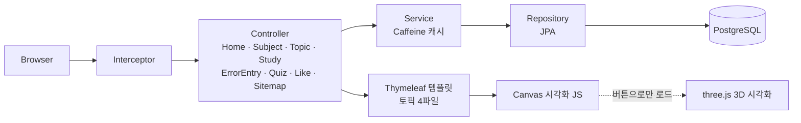

### 토픽 구성

토픽 하나는 아래 4개 파일로 이루어지고, 10개 토픽 단위 폴더로 묶습니다. 시각화 파일은 2D(`2d/`)와 3D(`3d/`)로 나눕니다.

```
templates/topics/{과목}/{묶음}/{slug}.html               큰 그림 · 작동 원리 · 퀴즈 뼈대
templates/fragments/code/{과목}/{묶음}/{slug}-code.html  코드 연결
static/css/visualizer/{과목}/{묶음}/2d/{slug}.css       시각화 스타일
static/js/visualizer/{과목}/{묶음}/2d/{slug}.js        시각화 로직
static/{css,js}/visualizer/{과목}/{묶음}/3d/{slug}.*   3D 시각화(three.js, 일부 토픽)
static/vendor/three/                                    three.js 자체 호스팅
```

## 개발자

| | |
|---|---|
|  | **Hasegos**<br>기획 · 설계 · 개발 · 배포 · 운영 전체<br>[GitHub](https://github.com/Hasegos) |

<br>

## 저작권

© 2025-2026 CS Flow. All rights reserved.

이 저장소의 소스 코드와 본문, 시각화는 저작권자의 허락 없이 복제 · 배포 · 상업적 이용을 할 수 없습니다.